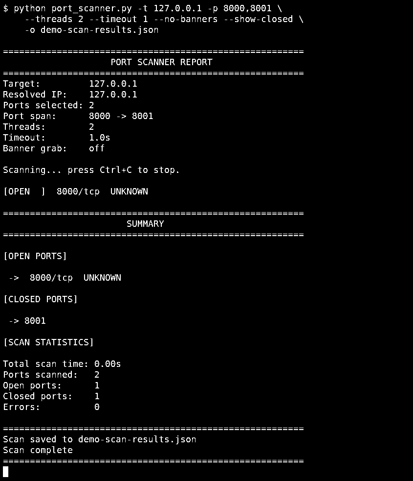

# Local TCP port scanner demonstration

This test was performed in an isolated environment against an HTTP server bound to the loopback address (127.0.0.1). The test output below was captured when the scanner was run.

## Reproduce

In terminal 1:

```bash
python -m http.server 8000 --bind 127.0.0.1
```

In terminal 2, from the scanner repository folder:

```bash
python port_scanner.py -t 127.0.0.1 -p 8000,8001 --threads 2 --timeout 1 --no-banners --show-closed -o demo-scan-results.json
```

Stop the HTTP server using Ctrl+C.

## Recorded results

- Port 8000: open
- Port 8001: closed
- Scan errors: 0



The image is an actual terminal screenshot captured during this local test, cropped and converted to monochrome for documentation. The scanner reports UNKNOWN for port 8000 because its service-name lookup is not full service fingerprinting. Results depend on the ports in use on the test system.

This test was conducted in an isolated environment, not on the repository owner's personal machine.
